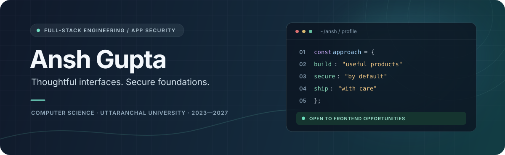
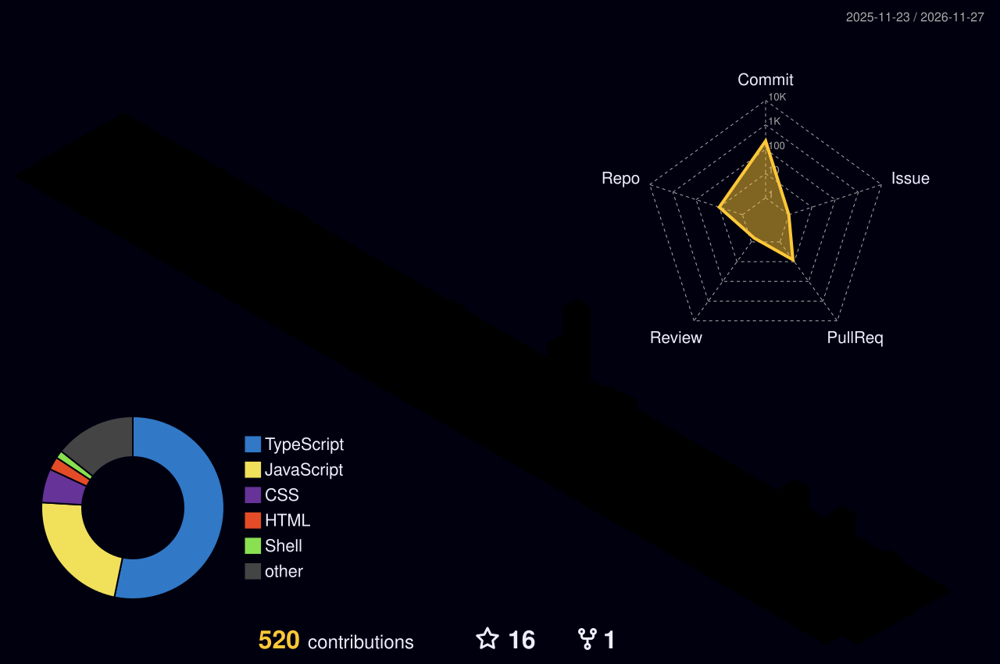

  

  
  
  

 

<table>
  <tr>
    <td width="62%" valign="top">
      01 &nbsp; / &nbsp; ABOUT
      <h2>Software with care built in.</h2>
      
I'm a frontend-leaning full-stack developer who enjoys turning ideas into useful, dependable products. I work primarily with React, JavaScript, Python, and Django REST Framework, with a strong interest in application security.

      
I’m pursuing a B.Tech in Computer Science at Uttaranchal University, Dehradun (2023–2027). I like bringing usability, backend engineering, and security together from the start.

    </td>
    <td width="38%" valign="top">
      IN PROGRESS
      <h3>DevSync</h3>
      
A place to find collaborators and bring project ideas to life.

      
        
      ALSO BUILDING
      
<strong>HOPE OS / Trust Exam Shield</strong> Offline exam security in kiosk mode.

    </td>
  </tr>
</table>

 

02 &nbsp; / &nbsp; SELECTED WORK

## Projects

<table>
  <tr>
    <td width="50%" valign="top">
      <h3>01 &nbsp; DevSync</h3>
      
A collaboration platform connecting people around project ideas. Serving 150+ users, with JWT/OAuth-secured ERP integration.

      
        
      
      
      
    </td>
    <td width="50%" valign="top">
      <h3>02 &nbsp; HOPE OS / Trust Exam Shield</h3>
      
An offline, kiosk-mode exam environment with dual-layer encryption, built for the Zuup Far Away Hackathon 2026.

       
      
      
      
    </td>
  </tr>
  <tr>
    <td colspan="2" valign="top">
      <h3>03 &nbsp; SIH 2024 · Automated Bus Scheduling</h3>
      
Route and scheduling system concept for the Delhi Transport Corporation, developed for Smart India Hackathon 2024.

    </td>
  </tr>
</table>

 

03 &nbsp; / &nbsp; TOOLKIT

## Tools I work with

  

FRONTEND &nbsp; · &nbsp; BACKEND &nbsp; · &nbsp; DATA &nbsp; · &nbsp; APPLICATION SECURITY &nbsp; · &nbsp; CLOUD

 

04 &nbsp; / &nbsp; BEYOND CODE

## Community & interests

Selected for **Smart India Hackathon 2024**; competed at **SSCBS Hackathon 2026** and the **JIC 2026** case competition by 180 Degrees Consulting. Senior Executive Member of the **Literary Committee** at Uttaranchal University. Outside of work: gaming, music, travel, and cooking.

 

05 &nbsp; / &nbsp; GITHUB

## Activity

  

  
More stats and contribution visuals

   
  

    
      
    
  

  
Contribution animations

   
  

    <picture>
      <source media="(prefers-color-scheme: dark)" srcset="https://raw.githubusercontent.com/Ansh-gupta-07/Ansh-gupta-07/output/github-contribution-grid-snake-dark.svg">
      <source media="(prefers-color-scheme: light)" srcset="https://raw.githubusercontent.com/Ansh-gupta-07/Ansh-gupta-07/output/github-contribution-grid-snake.svg">
      
    </picture>
      
    <picture>
      <source media="(prefers-color-scheme: dark)" srcset="./profile-3d-contrib/profile-night-rainbow.svg">
      <source media="(prefers-color-scheme: light)" srcset="./profile-3d-contrib/profile-green-animate.svg">
      
    </picture>
  

Thanks for stopping by. Feel free to connect on <a href="https://linkedin.com/in/ansh-gupta-406381294">LinkedIn</a>.

